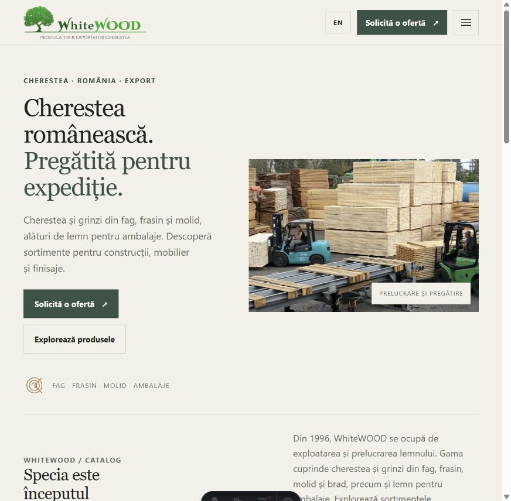
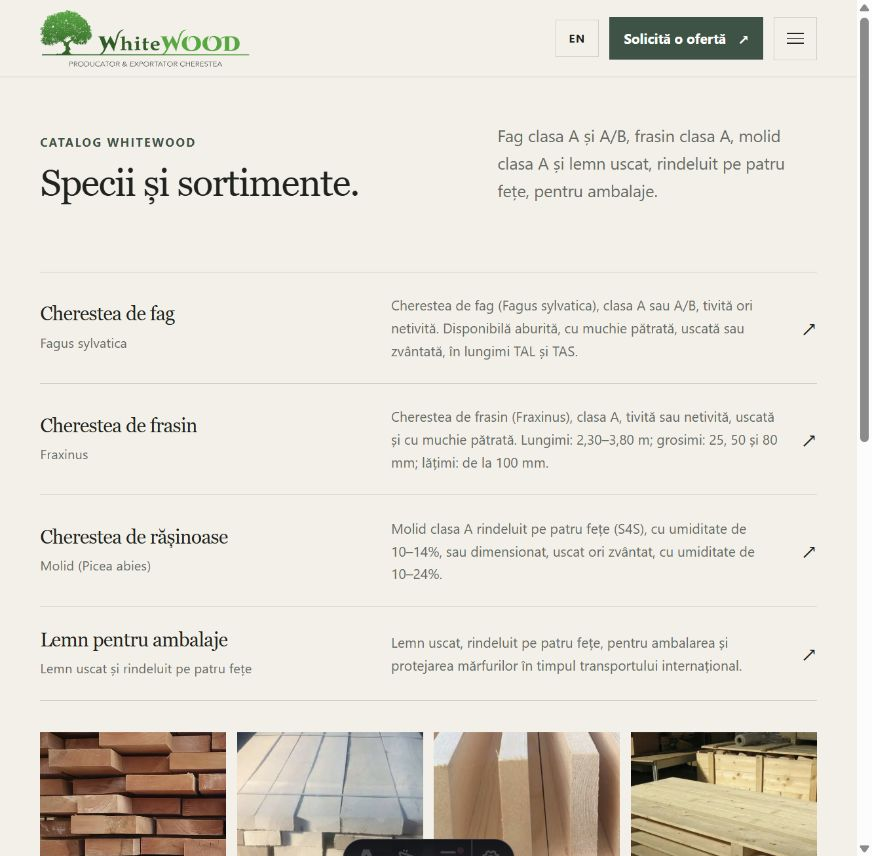
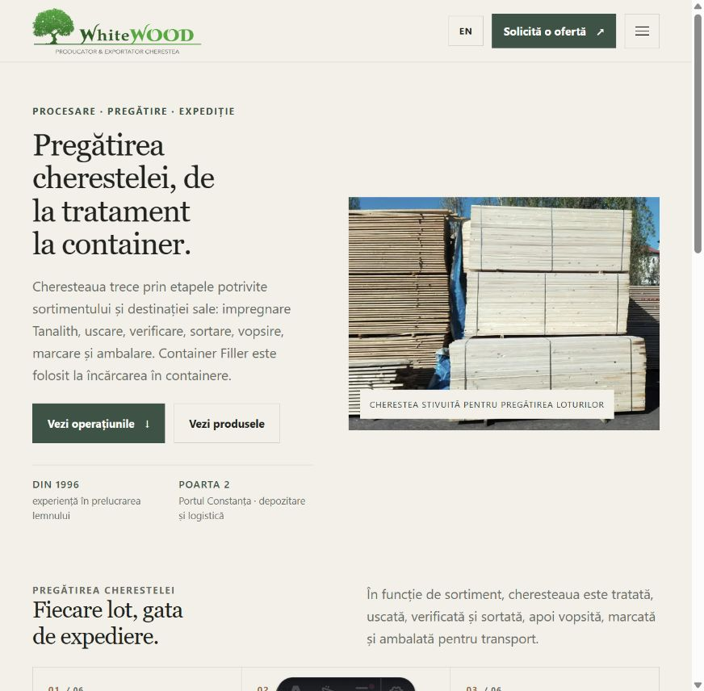

# WhiteWOOD SRL — website

Site bilingv RO/EN pentru WhiteWOOD, cu pagini editoriale randate pe server, catalog din D1, formular B2B și administrare privată.

## Capturi de ecran

### Pagina principală



### Catalog produse



### Procesare și logistică



## Cerințe

- Node.js 22.12+ (sau mai nou)
- npm

Nu este necesar un cont Cloudflare pentru dezvoltare. Wrangler rulează D1 local cu aceeași schemă ca D1 din producție.

## Dezvoltare locală

Din acest director:

```powershell
npm ci
npm run db:setup:local
npm run dev
```

Deschide adresa locală afișată de Astro. Setup-ul creează `.dev.vars` numai dacă fișierul nu există, aplică migrațiile cu `--local`, încarcă date demo și indexul asset-urilor în D1 local. Datele persistă în `.wrangler/`, director exclus din Git. `npm run dev` pregătește derivatele AVIF/WebP în `public/images/`; copiile media originale rămân în `media/originals/`, în afara directorului public.

Pentru primul cont local, deschide `/admin/setup/`, completează e-mailul și o parolă de minimum 12 caractere și folosește tokenul din fișierul local ignorat `.dev.vars`. Pagina de inițializare se închide după crearea primului cont. Nu există cont sau parolă implicită.

Cererea trimisă în modul local este marcată `LOCAL DEMO`, stocată numai în D1 local și vizibilă din `/admin/requests/`. Nicio e-mailare nu este configurată. Formularul local nu indică o trimitere către companie.

## Verificare și build

```powershell
npm run check
npm run build
npm run preview
```

`npm run build` pregătește versiunea destinată producției. Fotografiile sunt copiate în `public/images/` numai când `PUBLIC_MEDIA_APPROVED=true` este configurat pentru producție; valoarea implicită este `false`. Setarea de runtime controlează și afișarea imaginilor. Derivatele se pot recrea cu `npm run assets:optimize`, fără a modifica originalele.

Comenzi pentru inventar și media:

```powershell
npm run assets:inventory
npm run assets:optimize
```

## D1 și migrații

Binding-ul server-side se numește `DB`. Dezvoltarea folosește D1 local persistent prin Wrangler, iar producția folosește baza D1 Cloudflare definită separat în `wrangler.jsonc`. Modul local nu folosește binding-ul de producție; indisponibilitatea bazei nu este confirmată ca salvare reușită și nu declanșează o trecere automată către altă bază.

Comenzi **locale** — nu accesează D1 Cloudflare:

```powershell
npm run db:migrate:local
npm run db:seed:local
npm run db:setup:local
npx wrangler d1 export whitewoodsrl-local --local --output=./backup-local.sql
```

Comenzi **remote** — intenționat neexecutate în această lucrare:

```powershell
npm run db:migrate:production
npx wrangler d1 export whitewoodsrl-production --remote --env production --output=./backup-production.sql
```

Înainte de orice comandă remote, creează/configurează D1 în contul WhiteWOOD și înlocuiește ID-ul placeholder cu ID-ul emis de Cloudflare în `wrangler.jsonc`. Comanda de migrare remote modifică schema bazei Cloudflare. Exporturile pot conține date personale și trebuie păstrate într-un loc cu acces controlat.

## Producție Cloudflare

Nu au fost create resurse Cloudflare, nu s-au rulat migrații remote și nu s-a făcut deploy. Pentru o lansare viitoare:

1. Configurează baza D1 de producție și ID-ul ei în `wrangler.jsonc`.
2. Revizuiește textele juridice și fluxul de prelucrare a cererilor; activează formularul numai după aprobarea informării.
3. Confirmă drepturile pentru fotografii și aprobă selecția folosită pe site.
4. Configurează secretele server-side:

   ```powershell
   npx wrangler secret put SESSION_SECRET --env production
   npx wrangler secret put ADMIN_BOOTSTRAP_TOKEN --env production
   ```

5. Configurează `PRIVACY_NOTICE_APPROVED=true` și `PUBLIC_MEDIA_APPROVED=true` în variabilele de producție numai după aprobările corespunzătoare. Pentru build, setează `PUBLIC_MEDIA_APPROVED=true` în mediul procesului de build sau în `wrangler.jsonc`.
6. Aplică migrațiile cu `npm run db:migrate:production`, apoi creează primul administrator la `/admin/setup/` folosind tokenul one-time. După bootstrap, șterge secretul `ADMIN_BOOTSTRAP_TOKEN` din mediul production.
7. Fă deploy numai după verificarea mediului, a ID-urilor și a aprobărilor:

   ```powershell
   npm run deploy:production
   ```

Lista numelor de variabile: `APP_MODE`, `SITE_ORIGIN`, `SESSION_SECRET`, `ADMIN_BOOTSTRAP_TOKEN`, `PRIVACY_NOTICE_APPROVED`, `PUBLIC_MEDIA_APPROVED`; `DB` este binding, nu secret text. Nu pune secrete în cod, în Git sau în browser. `.dev.vars` este ignorat de Git.

## Pagini și URL-uri

- RO: `/ro/`, `/ro/produse/`, `/ro/proces/`, `/ro/despre/`, `/ro/articole/`, `/ro/contact/`, `/ro/confidentialitate/`, `/ro/cookies/`.
- EN: `/en/`, `/en/products/`, `/en/process/`, `/en/about/`, `/en/articles/`, `/en/contact/`, `/en/privacy/`, `/en/cookies/`.
- Produsele și articolele au pagini de detaliu; numai produse confirmate și articole aprobate sunt publicate.
- Administrare: `/admin/` cu login, configurare inițială, catalog/categorii, pagini bilingve, articole, traduceri, bibliotecă media, cereri, note și jurnal.
- Redirect-urile URL-urilor vechi sunt definite în `astro.config.mjs`. Articolele vechi duc la arhiva de articole până la revizie.
- `sitemap.xml` include paginile publice, produsele și articolele aprobate; `robots.txt` exclude adminul și API-ul.

## Starea conținutului înainte de lansare

Consultați [planul de implementare](docs/IMPLEMENTATION_PLAN.md) și [inventarul de asset-uri](docs/ASSET_INVENTORY.md). Înainte de publicare, WhiteWOOD trebuie să reconfirme datele de contact, stocul și oferta curentă, specificațiile/umiditatea/dimensiunile, tratamentele și certificările, traseele logistice, utilizările comerciale ale fotografiilor și textele de confidențialitate/cookies. Câmpurile tehnice de demo nu se publică în producție până la confirmare.

Formularul nu acceptă atașamente: nu este configurată o stocare de fișiere. Seed-ul local oglindește datele de contact de pe pagina curentă WhiteWOOD; confirmarea lor directă rămâne necesară înainte de importul în D1 de producție. Nu se afișează hartă de export, capacități sau certificări.

## Referințe tehnice oficiale

- [Astro Cloudflare adapter](https://docs.astro.build/en/guides/integrations-guide/cloudflare/)
- [Dezvoltare locală D1](https://developers.cloudflare.com/d1/best-practices/local-development/)
- [Migrații D1](https://developers.cloudflare.com/d1/reference/migrations/)
- [Comenzi Wrangler D1 și export](https://developers.cloudflare.com/d1/wrangler-commands/)
